<h2>Hi, I'm Animesh Sen 👋</h2>

  

  
  
  

### `$ who am i`

Developer at **Covlant.ai**, building APIs and web apps with TypeScript and Node.js. I like clean backends, well-tested code, and using AI tools to ship faster.

- 🔭 Currently building **[spendly](https://github.com/code-with-sen/spendly)**, an expense tracker made with Claude Code
- 🧪 Writing tests with **Jest** and learning more about testing strategy
- ⚙️ Working with **Express + PostgreSQL** APIs and **Next.js** frontends
- 🤝 Open to collaborating on TypeScript, Node.js and AI-tooling projects

### `$ ls ./stack`

  

### `$ ./featured.sh`

| Project | What it is | Stack |
|---|---|---|
| [**spendly**](https://github.com/code-with-sen/spendly) | Expense tracking app built using Claude Code | CSS, JS |
| [**typescript-api-starter01**](https://github.com/code-with-sen/typescript-api-starter01) | Express.js / PostgreSQL API starter template | TypeScript |
| [**Covlant.NextPage**](https://github.com/code-with-sen/Covlant.NextPage) | Next.js web pages | JavaScript |
| [**testing_guide-covalent-**](https://github.com/code-with-sen/testing_guide-covalent-) | Notes on TypeScript and Jest | HTML |

### `$ git log --graph`

  <picture>
    <source media="(prefers-color-scheme: dark)" srcset="https://raw.githubusercontent.com/code-with-sen/code-with-sen/output/snake-dark.svg?v=3" />
    <source media="(prefers-color-scheme: light)" srcset="https://raw.githubusercontent.com/code-with-sen/code-with-sen/output/snake.svg?v=3" />
    
  </picture>

